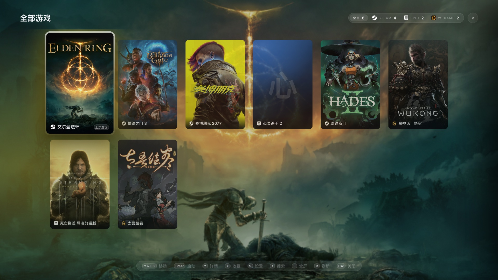
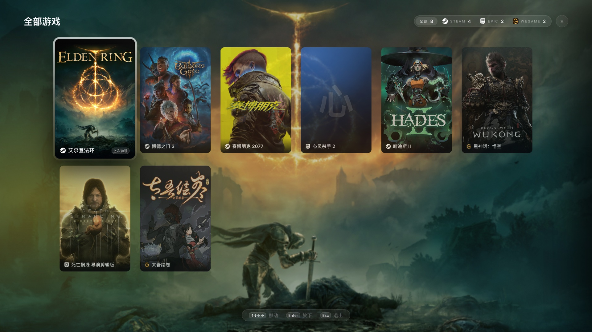

# Game Launcher

一个**主机手感**的 PC 游戏启动器：把 Steam / Epic / WeGame 三个库合成一页，封面、主色、游玩时长、收藏都在同一个界面里，键盘、鼠标、手柄随便用。

界面是 Web（Vue 3 + Vite），外壳是 Go 写的无边框原生窗口（[mygo](https://github.com/egoist/mygo)），扫库、抓封面、起进程、读手柄全在 Go 侧 —— **没有 cgo，一份代码跨 macOS / Windows**。


## 特性

| | |
|---|---|
| **三个平台合并** | Steam（`libraryfolders.vdf` + `appmanifest`）、Epic（`*.item` 清单）、WeGame 一起扫，同一个网格里排 |
| **主视觉背景** | 从封面取主色做光晕；有没有 hero 大图都能看（没有就拿封面模糊放大顶上） |
| **手柄优先** | 插上就按设备画键位（Xbox `A` / PS `✕` / 任天堂 `B`），肩键换卡片、扳机换平台、长按 `Y` 进搬动模式 |
| **自定义顺序** | 网格里直接拖卡片，或键盘 `M` / 手柄长按 `Y` 用方向键摆位；顺序落到 `settings.Order` |
| **详情抽屉** | 时长、占用、安装位置、AppID、上次启动；启动 / 收藏 / 隐藏 / 卸载（二次确认，卸载走 `steam://`） |
| **搜索与收藏** | `/` 就地搜全库；收藏置顶（切到自定义顺序后不再置顶，免得刚挪下去的收藏被弹回顶部） |
| **开机画面** | 写在 `index.html` 里内联，JS 包还没解析完就先画出来，最短 2 秒 |

## 截图

| 全部游戏（同一页的另一套布局） | 拖动排序 |
|---|---|
|  |  |

| 详情抽屉 | 设置 |
|---|---|
|  |  |

首页的卡片带和「全部游戏」的网格**是同一批 DOM**：按 `G` 只是换个布局，卡片会自己散开 / 收拢（FLIP，位移和尺寸一起插值），不重新加载封面、不闪烁。

## 操作

一个键只有一个意思：`A` 启动、`Y` 详情、`X` 收藏、`B` / `Esc` 返回。

| 操作 | 键盘 | Xbox | PlayStation | Switch |
|---|---|---|---|---|
| 移动光标 | ↑ ↓ ← → | 十字键 / 左摇杆 | 同左 | 同左 |
| 换卡片 | ← → | `LB` / `RB` | `L1` / `R1` | `L` / `R` |
| 换平台（网格） | 点胶囊 | `LT` / `RT` | `L2` / `R2` | `ZL` / `ZR` |
| 启动 / 确认 | `Enter` / `Space` | `A` | `✕` | `B` |
| 详情 | `Y` | `Y` | `△` | `X` |
| 收藏 | `X` | `X` | `□` | `Y` |
| 进网格 / 回卡片带 | `G` | `View` | `Create` | `−` |
| 调整顺序 | 网格里 `M` | 网格里长按 `Y` | 长按 `△` | 长按 `X` |
| 设置 | `S` | `Menu` | `Options` | `+` |
| 搜索 | `/` | — | — | — |
| 全屏 | `F` | —（只在设置里切） | — | — |
| 重新扫描库 | `R` | — | — | — |
| 返回 / 关闭 | `Esc` | `B` | `○` | `A` |

提示条会跟着最近一次输入切换：用键盘就显示按键名，握手柄就显示键位符号。

## 技术栈

```
┌──────────────────────────────────────────────┐
│  mygo 窗口（Frameless，原生 WebView）          │
│  ┌─────────────────────────────────────────┐ │
│  │ Web 前端：Vue 3 + Pinia + Vite (TS)      │ │
│  └───────────────┬─────────────────────────┘ │
│                  │ window.mygo.call(...)      │
│  ┌───────────────┴─────────────────────────┐ │
│  │ Go 后端：扫库 / art:// 协议 / 启动 / 手柄  │ │
│  └─────────────────────────────────────────┘ │
└──────────────────────────────────────────────┘
```

- 前端只能通过 `src/mygo.ts`（由 `mygo generate` 按 Go 侧 `Bind` 的方法自动生成）碰系统能力
- 封面走自定义协议 `art://`（Windows 上是 `http://art.localhost`），页面拿不到真实路径，也不能顺着 id 读别的文件
- 没扫到真实库时自动进**演示数据**模式，方便直接看版式

## 开发

需要 Go 1.27+ 和 [Bun](https://bun.sh)。

```bash
bun install
bun run dev            # mygo dev：Vite + 开发版应用
bun run dev:web        # 只跑 Vite，浏览器里调样式（自动用演示数据）
bun run typecheck      # tsc --noEmit（注意：查不到 .vue 里的 <script setup>）
```

> `.vue` 的 script 改动 `tsc` 是看不到的，所以改了就必须真跑一遍界面。
> 要连后端方法，改完 `app.go` 记得 `bun run generate`。

### 测试

```bash
go vet ./...
LAUNCHER_NO_STORE_ASSETS=1 go test ./...     # 133 个用例：VDF/ACF 解析、扫描、服务层
```

`LAUNCHER_NO_STORE_ASSETS=1` 别省：否则重扫会去 `store.steampowered.com` 拉图，直连超时会让测试挂几分钟（CPU 时间为 0，很像卡死）。

虚拟机手柄 E2E 见 `scripts/e2e-pad.py`，真机自动化协议见 `docs/PLAN.md` 的测试一节。

## 打包

```bash
bun run build                                    # 当前平台
npx mygo build -platform windows/amd64           # Windows exe + NSIS 安装包
MYGO_INSPECTOR=1 npx mygo build -debug -skip-dmg -skip-notarize   # 带调试的 macOS 包
```

- macOS 产物是签名后的 `.app` + `.dmg`；Windows 是裸 `Game Launcher.exe` 加 `game-launcher-setup-<version>-amd64.exe`
- NSIS 安装包需要 `makensis`：Windows 上 `mygo build` 会自己下载，macOS 上 `brew install makensis`
- Windows 包未签名，首次运行会有 SmartScreen 提示

## 环境变量

| 变量 | 作用 |
|---|---|
| `LAUNCHER_STEAM_DIR` | 指定 Steam 库目录（不设就按系统默认位置找） |
| `LAUNCHER_EPIC_DIR` | 指定 Epic 清单目录 |
| `LAUNCHER_WEGAME_DIR` | 指定 WeGame 库目录 |
| `LAUNCHER_NO_STORE_ASSETS` | 关掉商店图查询（测试用） |
| `MYGO_INSPECTOR` / `MYGO_AUTOMATION` | 调试构建的检查器 / 自动化 socket |

## 目录

```
app.go                      暴露给前端的后端方法
main.go                     窗口、协议、扫库循环
internal/steam|epic|wegame/ 各家库的扫描与解析
internal/launch/            按平台启动外部程序
internal/config/            设置落盘
internal/artcache|storeart/ 封面缓存与商店图
src/                        Vue 前端（App.vue + components/ + stores/）
docs/PLAN.md                设计与踩坑记录（这套东西为什么长这样，都在里面）
```

## 文档

设计决策、动画方案、手柄语义、踩过的坑，都写在 [`docs/PLAN.md`](docs/PLAN.md) —— 想改这块的话先看一眼，很多「看起来多余」的写法都是有原因的。
